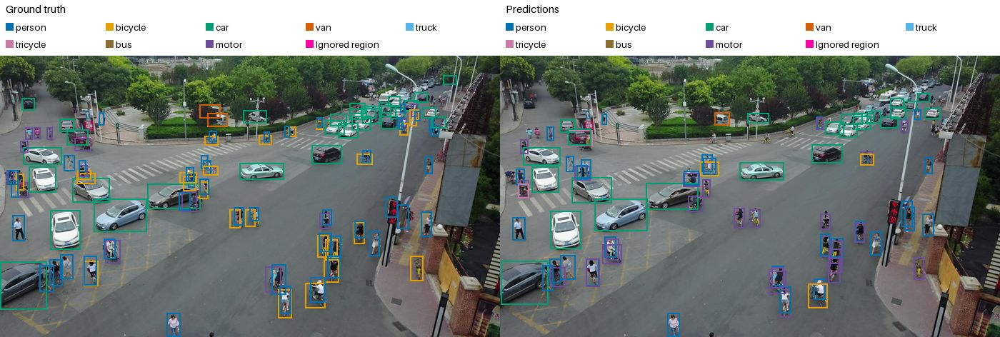

## EDA (Exploratory Data Analysis)

During the EDA phase, our goal was to understand the dataset and make sure that nothing in it would silently invalidate training or evaluation.

Remark about coordinate systems:

The dataset uses three conventions.

This could cause issues, as a conversion error still produces a valid file that scores near zero.

YOLO labels store the box center and size normalized to the image width and height, with class IDs 0 to 7.

COCO annotations store the top-left corner and size in the original pixels, with category IDs 1 to 8.

The submission expects the COCO layout in original pixels but the YOLO class IDs. We convert with $x = (c_x - w/2) W$, $y = (c_y - h/2) H$, width $w W$, height $h H$ and class = category - 1. Ignored regions use the YOLO layout without a class. Our final model sees a frame resized so that its longer side is 1280 px.

### EDA Findings

Object size: 24.4% of the boxes are COCO small (by COCO convention, below 32x32 px), with median areas from 1 344 $\mathrm{px}^2$ for person to 12 470 $\mathrm{px}^2$ for bus ([01_eda, Section 4](https://nbviewer.org/github/ke1rro/hm2/blob/main/notebooks/01_eda.ipynb#4.-Object-sizes)).

The relevant size is the one after resizing, however. With a 1024 px long side, as in our first detectors, the median box side is 24 px ([02_retinanet, Section 4](https://nbviewer.org/github/ke1rro/hm2/blob/main/notebooks/02_retinanet.ipynb#4.-Smaller-anchor-scales)). With a 1280 px long side, the median is 30 px and 9.5% are below 16 px ([10_yolo11s_native_pipeline, Section 4](https://nbviewer.org/github/ke1rro/hm2/blob/main/notebooks/10_yolo11s_native_pipeline.ipynb#4.-Sampling-summary-and-annotation-checks)). The final model therefore uses 1280 px.

Density: A training frame contains 45.7 objects on average, with a median of 43, a 99th percentile of 142 and a maximum of 180 ([01_eda, Section 5](https://nbviewer.org/github/ke1rro/hm2/blob/main/notebooks/01_eda.ipynb#5.-Objects-per-frame)). We use a confidence threshold of 0.001 and up to 500 detections per frame. Raising the threshold to 0.05 lowered mAP by 0.39 points ([11_yolo11s_tuning_experiments, Section 6](https://nbviewer.org/github/ke1rro/hm2/blob/main/notebooks/11_yolo11s_tuning_experiments.ipynb#6.-Inference-strategies-on-the-best-checkpoint)).

Class imbalance: Car accounts for 44.0% of the boxes, person 31.1% and bus for 0.8% ([01_eda, Section 3](https://nbviewer.org/github/ke1rro/hm2/blob/main/notebooks/01_eda.ipynb#3.-Class-distribution)).

On the clean validation fold, AP follows object size more than frequency: bus reaches 0.66 and bicycle 0.13 ([10_yolo11s_native_pipeline, Section 10](https://nbviewer.org/github/ke1rro/hm2/blob/main/notebooks/10_yolo11s_native_pipeline.ipynb#10.-Per-class,-size-and-clip-results)). Repeat-factor sampling did not give a consistent gain ([09_repeat_factor_sampling, Section 7](https://nbviewer.org/github/ke1rro/hm2/blob/main/notebooks/09_repeat_factor_sampling.ipynb#7.-Interpretation-and-limitations)). The failure analysis shows that among predictions with score at least 0.3, 24 to 29% of van, truck and bicycle objects are assigned to another class ([10_yolo11s_native_pipeline, Section 11](https://nbviewer.org/github/ke1rro/hm2/blob/main/notebooks/10_yolo11s_native_pipeline.ipynb#11.-Failure-analysis)).

Train and test: labeled frames are 1344 to 3840 px wide, while test frames are 680 to 1920 px ([01_eda, Section 6](https://nbviewer.org/github/ke1rro/hm2/blob/main/notebooks/01_eda.ipynb#6.-Resolution-and-split-differences)).

Independence: the same object keeps a median IoU of 0.90 between neighboring frames ([10_yolo11s_native_pipeline, Section 4](https://nbviewer.org/github/ke1rro/hm2/blob/main/notebooks/10_yolo11s_native_pipeline.ipynb#4.-Sampling-summary-and-annotation-checks)), so every split keeps whole clips and the final validation is grouped by video ([12_yolo11s_grouped_cv, Section 2](https://nbviewer.org/github/ke1rro/hm2/blob/main/notebooks/12_yolo11s_grouped_cv.ipynb#2.-Validation-pool-and-folds)).

## Evaluation

In this homework, we used RetinaNet, Faster R-CNN, RT-DETRv2 and YOLO11s.
Their first runs used the same setup:

4,868 training frames (every 5th frame of 56 clips), 2,846 validation frames from 7 other clips, images resized to a shorter side of 640 and a longer side of at most 1024 pixels, 5 epochs, 2 images per update, seed 2026, left-right flip with probability 0.5.

All four start from COCO-pretrained weights, and Faster R-CNN, RetinaNet and RT-DETRv2 share a ResNet-50 backbone, so their differences come mainly from the detection head and the way predictions are assigned to objects, not from feature extraction.

The later YOLO11s pipeline starts instead from weights trained on VisDrone-DET, so its gain over these runs comes from initialization and data, not from the architecture alone.

Our metrics for a predicted box $B_p$ and a ground-truth box $B_g$,

$$\mathrm{IoU}(B_p, B_g) = \frac{|B_p \cap B_g|}{|B_p \cup B_g|}.$$

For one class and one IoU threshold $t$, predictions are sorted by score and matched greedily: a prediction is a true positive if it has the same class and $\mathrm{IoU} \ge t$ with a ground-truth box that is not matched yet, and a false positive otherwise. Walking down the sorted list gives precision $P = TP/(TP + FP)$ and recall $R = TP/N_{gt}$. COCO averages the interpolated precision $P_{\mathrm{interp}}(r) = \max_{r' \ge r} P(r')$ at 101 recall levels:

$$\mathrm{AP}_{c,t} = \frac{1}{101} \sum_{r \in \{0, 0.01, \dots, 1\}} P_{\mathrm{interp}}(r).$$

The main score averages this over the 8 classes and the 10 thresholds $T = \{0.50, 0.55, \dots, 0.95\}$:

$$\mathrm{mAP} = \frac{1}{8 \cdot 10} \sum_{c} \sum_{t \in T} \mathrm{AP}_{c,t}.$$

AP50 uses only $t = 0.5$, and AP small counts only ground-truth boxes with an area below $32^2$ $\mathrm{px}^2$ in the original image. At most 100 detections per image and class are kept. Ignored regions enter as COCO crowd regions: a detection that falls inside one, measured as the share of the detection covered by the region, is removed instead of counted as a false positive. The Kaggle metric is not published, so this COCO mAP is our proxy, and the Public leaderboard (about 14 test clips) is a second, noisy measurement.

## One-stage anchor-based: RetinaNet

We fine-tuned the COCO-pretrained RetinaNet ResNet-50 FPN V2 and ran four experiments in a 2x2 design: standard or halved anchor sizes, trained on every fifth frame (4,868) or on all 24,201 frames ([02_retinanet, Section 1](https://nbviewer.org/github/ke1rro/hm2/blob/main/notebooks/02_retinanet.ipynb#1.-Setup-and-training-configuration), [03_retinanet_results, Section 2](https://nbviewer.org/github/ke1rro/hm2/blob/main/notebooks/03_retinanet_results.ipynb#2.-Validation-at-epoch-5)). Halving the anchors targets the small objects found in the EDA, and the full training set tests whether more frames help.

| Anchors  | Frames    | Checkpoint |   mAP |  AP50 | AP small | AP large | Public |
| -------- | --------- | ---------- | ----: | ----: | -------: | -------: | -----: |
| standard | every 5th | epoch 5    | 0.153 | 0.291 |    0.053 |    0.317 |  0.160 |
| halved   | every 5th | epoch 5    | 0.149 | 0.316 |    0.052 |    0.276 |  0.142 |
| standard | all       | epoch 1    | 0.158 | 0.299 |    0.053 |    0.327 |  0.168 |
| halved   | all       | epoch 4    | 0.159 | 0.333 |    0.058 |    0.306 |  0.160 |

The initial frame size is up to 3840x2160 px, and our setup used batch size 2 and 5 epochs. Full size frames would not fit into our Tesla T4 budget, so we resized the shorter side to 640 px and the longer side to at most 1024 px (1024x576 for our frames).

The smallest standard anchor is 32 px, so a 13 px box (the 10th percentile) reaches an IoU of at most $13^2/32^2 \approx 0.17$ with it and is never a regular positive. 

Halved anchors start at 16 px (IoU up to 0.66). They raised AP50 in both data settings (+2.5 and +3.9 points at epoch 5), so more small objects are found. AP small barely moved (-0.1 and +0.5 points), however, and AP large fell (-4.0 and -1.7 points). The clearest loser is bus, the largest class: its AP fell from 0.038 to 0.009 with every fifth frame and from 0.087 to 0.013 with all frames ([03_retinanet_results, Section 5](https://nbviewer.org/github/ke1rro/hm2/blob/main/notebooks/03_retinanet_results.ipynb#5.-Class-AP-at-epoch-5)). Smaller anchors trade large objects for coarse detection of small ones, while precise localization of small objects stays limited by the resolution of the input.

Just to prove that full dataset does not necessarily lead to better performance, training on all frames gave five times more updates but no consistent gain (-0.2 and +0.8 points mAP at epoch 5). That is why we stayed on using stride values in our experiments. 

Comparison with Faster R-CNN. Under the same budget RetinaNet with standard anchors reached 0.153 mAP and 0.053 AP small, against 0.175 and 0.081 for Faster R-CNN, and 0.160 against 0.204 on Public. The comparison is not purely about the architecture: stock RetinaNet treats ignored regions as background, while our Faster R-CNN excludes negatives inside them.

Here is example of dense validation frame below, cars and pedestrians are found reliably, but there are a few mispredictions: several bicycles are predicted as motor.

