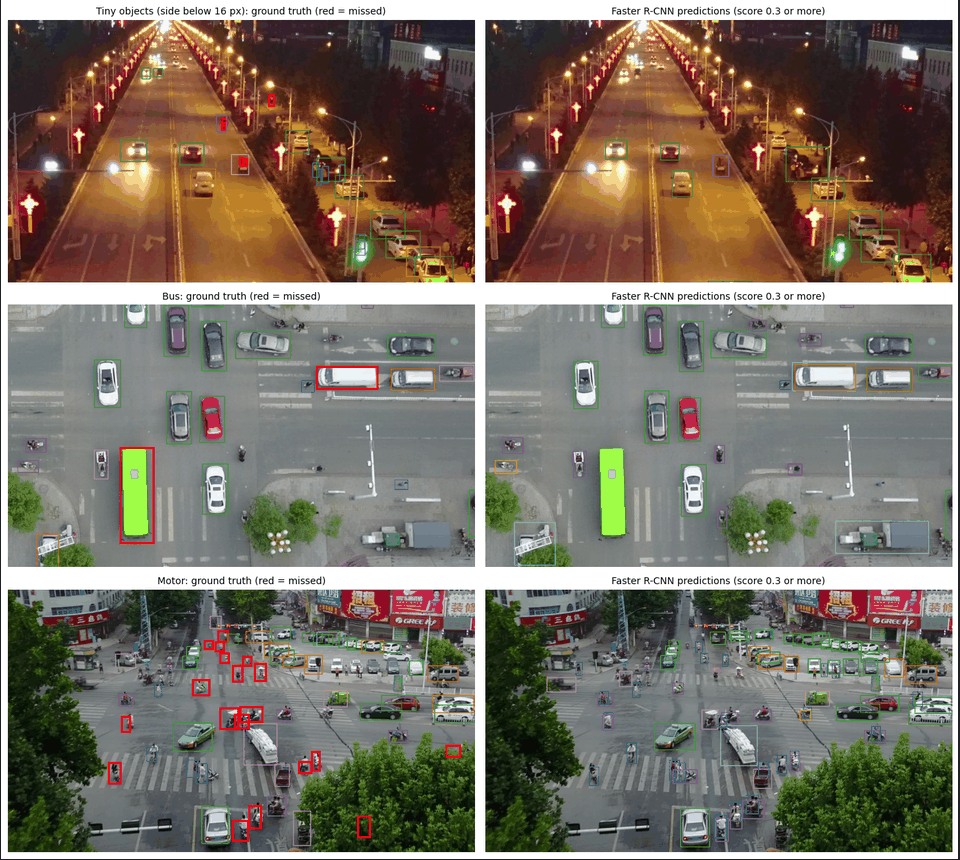
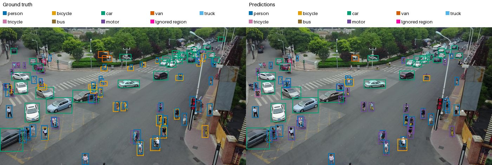
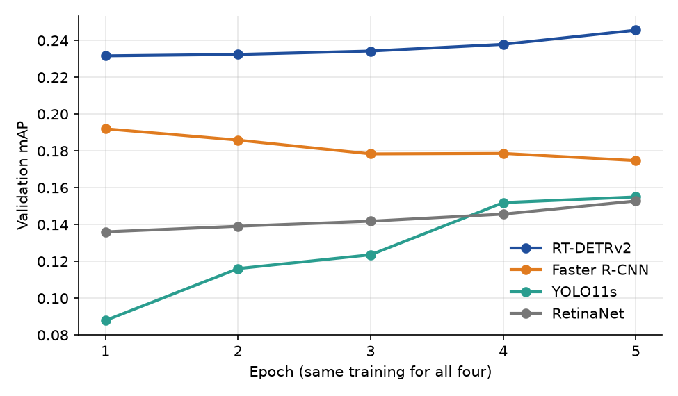

## Summary

The task is to find objects in drone videos (VisDrone2019-VID) and mark each with a box and one of eight classes. Most objects are small, and scenes are often crowded. Areas called ignore regions are too crowded to annotate, so detections there are not counted as mistakes.

We trained four detector families under the same budget: two-stage (Faster R-CNN), one-stage with
anchors (RetinaNet), one-stage without anchors (YOLO11s) and query-based (RT-DETRv2). With this equal
training, RT-DETRv2 was the most accurate.

The final pipeline builds on these experiments. Objects are tiny, so it uses larger images (1280 pixels). For the final model we chose YOLO11s and used a stronger recipe, started from weights of a public model trained on a similar drone dataset, VisDrone-DET (external data). We selected two final submissions, which reach Public scores of 0.359 and 0.362.
## EDA (Exploratory Data Analysis)

During the EDA phase, our goal was to understand the dataset and make sure that nothing in it would silently invalidate training or evaluation.

Remark about coordinate systems:

The dataset uses three conventions, and a conversion error still produces a valid file that scores near zero.

YOLO labels store the normalized box center and size, with class IDs 0 to 7.

COCO annotations store the top-left corner and size in pixels, with category IDs 1 to 8.

The submission uses the COCO layout with YOLO class IDs, so we convert with $x = (c_x - w/2) W$, $y = (c_y - h/2) H$, width $w W$, height $h H$ and class = category - 1.

### EDA Findings

Object size: 24.4% of the boxes are COCO small (by COCO convention, below 32x32 px), with median areas from 1 344 $\mathrm{px}^2$ for person to 12 470 $\mathrm{px}^2$ for bus ([01_eda, Section 4](https://nbviewer.org/github/ke1rro/hm2/blob/main/notebooks/01_eda.ipynb#4.-Object-sizes)).

The relevant size is the one after resizing, however. With a 1024 px long side, as in our first detectors, the median box side is 24 px ([02_retinanet, Section 4](https://nbviewer.org/github/ke1rro/hm2/blob/main/notebooks/02_retinanet.ipynb#4.-Smaller-anchor-scales)). With a 1280 px long side, the median is 30 px and 9.5% are below 16 px ([10_yolo11s_native_pipeline, Section 4](https://nbviewer.org/github/ke1rro/hm2/blob/main/notebooks/10_yolo11s_native_pipeline.ipynb#4.-Sampling-summary-and-annotation-checks)). The final model therefore uses 1280 px.

Density: A training frame contains 45.7 objects on average, with a median of 43, a 99th percentile of 142 and a maximum of 180 ([01_eda, Section 5](https://nbviewer.org/github/ke1rro/hm2/blob/main/notebooks/01_eda.ipynb#5.-Objects-per-frame)). Raising the confidence threshold from 0.001 to 0.05 lowered mAP by 0.39 points ([11_yolo11s_tuning_experiments, Section 6](https://nbviewer.org/github/ke1rro/hm2/blob/main/notebooks/11_yolo11s_tuning_experiments.ipynb#6.-Inference-strategies-on-the-best-checkpoint)).

Class imbalance: Car accounts for 44.0% of the boxes, person 31.1% and bus for 0.8% ([01_eda, Section 3](https://nbviewer.org/github/ke1rro/hm2/blob/main/notebooks/01_eda.ipynb#3.-Class-distribution)).

On the clean validation fold, AP follows object size more than frequency: bus reaches 0.66 and bicycle 0.13 ([10_yolo11s_native_pipeline, Section 10](https://nbviewer.org/github/ke1rro/hm2/blob/main/notebooks/10_yolo11s_native_pipeline.ipynb#10.-Per-class,-size-and-clip-results)). The failure analysis shows that among predictions with score at least 0.3, 24 to 29% of van, truck and bicycle objects are assigned to another class ([10_yolo11s_native_pipeline, Section 11](https://nbviewer.org/github/ke1rro/hm2/blob/main/notebooks/10_yolo11s_native_pipeline.ipynb#11.-Failure-analysis)).

Independence: the same object keeps a median IoU of 0.90 between neighboring frames ([10_yolo11s_native_pipeline, Section 4](https://nbviewer.org/github/ke1rro/hm2/blob/main/notebooks/10_yolo11s_native_pipeline.ipynb#4.-Sampling-summary-and-annotation-checks)), so every split keeps whole clips.

## Evaluation

The first runs of all four families used the same setup:

4,868 training frames (every 5th frame of 56 clips), 2,846 validation frames from 7 other clips, images resized to a shorter side of 640 and a longer side of at most 1024 pixels, 5 epochs, 2 images per update, seed 2026, left-right flip with probability 0.5.

All four start from COCO-pretrained weights, and Faster R-CNN, RetinaNet and RT-DETRv2 share a ResNet-50 backbone, so their differences come mainly from the detection head.

Our metrics for a predicted box $B_p$ and a ground-truth box $B_g$,

$$\mathrm{IoU}(B_p, B_g) = \frac{|B_p \cap B_g|}{|B_p \cup B_g|}.$$

A prediction is a true positive if it has the same class and $\mathrm{IoU} \ge t$ with a ground-truth box that is not matched yet. AP is the area under the precision-recall curve of one class, and the main score, mAP, averages it over the 8 classes and the IoU thresholds $t = 0.50, 0.55, \dots, 0.95$.

AP50 uses only $t = 0.5$, and AP small counts only ground-truth boxes with an area below $32^2$ $\mathrm{px}^2$ in the original image. At most 100 detections per image and class are kept. Ignored regions enter as COCO crowd regions: a detection that falls inside one, measured as the share of the detection covered by the region, is removed instead of counted as a false positive. The Kaggle metric is not published, so this COCO mAP is our proxy, and the Public leaderboard (about 14 test clips) is a second, noisy measurement.

## Two-stage anchor-based: Faster R-CNN

We train it with SGD at learning rate 0.0025. Our change is in the loss: a background candidate that is more than half covered by an ignore region is removed from the loss of both stages, so finding a real object there is not punished.

On validation, Faster R-CNN reaches mAP 0.175, AP50 0.354 and AP small 0.081, and needs 94 ms per frame.

**Failure cases** \
The figure shows the worst validation frames: at night all 5 objects below 16 pixels are missed, both buses are missed (one gets a truck box), and in a crowd 21 of 25 motorcycles are missed although many riders are found. The score also falls during training (0.192 after epoch 1, 0.175 after epoch 5), possibly from overfitting.

### Tuning the two-stage detector

**Number of region proposals.** \
On the finished baseline we changed only the number of proposals per image at inference (300, 1000 and 2000). More proposals do not help: mAP changes by 0.001 and AP small not at all, so the weak result on tiny objects (AP small 0.081) more likely comes from the first stage, its anchors and feature map resolution.

**Share of positive boxes.** \
The second stage trains on 512 boxes per image, of which only 25 percent were positive, so we raised the share to 50 percent: validation mAP hardly changed (0.177 against 0.175), bus improved most (0.039 against 0.015) and Public rose from 0.204 to 0.213, the best of our Faster R-CNN runs. With one seed and 14 test clips this gain may be noise, and the score still falls after epoch 1 (0.200 after epoch 1, 0.177 after epoch 5).

### Data experiments

On the Faster R-CNN baseline we tested three data changes, one at a time: color jitter for the lighting differences between videos, a larger input for small objects, and repeat-factor sampling, which shows images with rare classes more often.

| Change | Val mAP | AP small | Public |
| --- | ---: | ---: | ---: |
| Baseline | 0.175 | 0.081 | 0.204 |
| Brightness, contrast and saturation jitter ([06, Section 7](https://nbviewer.org/github/ke1rro/hm2/blob/main/notebooks/06_photometric_augmentation.ipynb#7.-Interpretation-and-limitations)) | 0.179 | 0.075 | 0.199 |
| Input 800/1280 instead of 640/1024 ([07, Section 7](https://nbviewer.org/github/ke1rro/hm2/blob/main/notebooks/07_input_resolution.ipynb#7.-Interpretation-and-limitations)) | 0.209 | 0.103 | 0.194 |
| Repeat-factor sampling of rare classes ([09, Section 7](https://nbviewer.org/github/ke1rro/hm2/blob/main/notebooks/09_repeat_factor_sampling.ipynb#7.-Interpretation-and-limitations)) | 0.182 | 0.086 | 0.196 |

All three raised validation mAP but lowered Public, so none was adopted. The larger input gave the clearest gain, mostly on small objects, which led us to train the final model at 1280 px.

## One-stage anchor-based: RetinaNet

We fine-tuned the COCO-pretrained RetinaNet ResNet-50 FPN V2 and ran four experiments in a 2x2 design: standard or halved anchor sizes, trained on every fifth frame (4,868) or on all 24,201 frames ([02_retinanet, Section 1](https://nbviewer.org/github/ke1rro/hm2/blob/main/notebooks/02_retinanet.ipynb#1.-Setup-and-training-configuration), [03_retinanet_results, Section 2](https://nbviewer.org/github/ke1rro/hm2/blob/main/notebooks/03_retinanet_results.ipynb#2.-Validation-at-epoch-5)). Halving the anchors targets the small objects found in the EDA, and the full training set tests whether more frames help.

| Anchors  | Frames    | Checkpoint |   mAP |  AP50 | AP small | AP large | Public |
| -------- | --------- | ---------- | ----: | ----: | -------: | -------: | -----: |
| standard | every 5th | epoch 5    | 0.153 | 0.291 |    0.053 |    0.317 |  0.160 |
| halved   | every 5th | epoch 5    | 0.149 | 0.316 |    0.052 |    0.276 |  0.142 |
| standard | all       | epoch 1    | 0.158 | 0.299 |    0.053 |    0.327 |  0.168 |
| halved   | all       | epoch 4    | 0.159 | 0.333 |    0.058 |    0.306 |  0.160 |

The smallest standard anchor is 32 px, so a 13 px box (the 10th percentile) reaches an IoU of at most $13^2/32^2 \approx 0.17$ with it and is never a regular positive.

Halved anchors start at 16 px (IoU up to 0.66). They raised AP50 in both data settings (+2.5 and +3.9 points at epoch 5), so more small objects are found. AP small barely moved (-0.1 and +0.5 points), however, and AP large fell (-4.0 and -1.7 points). The clearest loser is bus, the largest class: its AP fell from 0.038 to 0.009 with every fifth frame and from 0.087 to 0.013 with all frames ([03_retinanet_results, Section 5](https://nbviewer.org/github/ke1rro/hm2/blob/main/notebooks/03_retinanet_results.ipynb#5.-Class-AP-at-epoch-5)). Smaller anchors trade large objects for coarse detection of small ones, while precise localization of small objects stays limited by the resolution of the input.

Training on all frames gave five times more updates but no consistent gain (-0.2 and +0.8 points mAP at epoch 5), so we kept a frame stride in later experiments.

Against Faster R-CNN (see Results), part of the gap is not about the architecture: stock RetinaNet treats ignored regions as background, while our Faster R-CNN excludes negatives inside them.

On the dense validation frame below, cars and pedestrians are found reliably, but there are a few mispredictions: several bicycles are predicted as motor.

## One-stage anchor-free: YOLO11s

With shared setup, COCO-pretrained YOLO11s reached 0.155 mAP and 0.143 on Public, still rising at epoch 5 ([08, Section 7](https://nbviewer.org/github/ke1rro/hm2/blob/main/notebooks/08_yolo_baseline.ipynb#7.-Interpretation-and-limitations)). By object size it had the best AP small of the CNN detectors but the worst AP large:

| Model | AP small | AP large |
| --- | ---: | ---: |
| RetinaNet | 0.053 | 0.317 |
| Faster R-CNN | 0.081 | 0.334 |
| YOLO11s | 0.092 | 0.285 |

## Query-based: RT-DETRv2

RT-DETRv2 has no anchors and no NMS: it predicts with 300 learned queries trained by Hungarian matching.

We use the COCO-pretrained PekingU/rtdetr_v2_r50vd. We changed the loss so that queries inside ignore regions are not punished.

Each experiment changes a single thing.

| Run           | Change                                                | Val mAP | Public |
| ------------- | ----------------------------------------------------- | ------- | ------ |
| baseline_q300 | none                                                  | 0.246   | 0.253  |
| nwd_loss      | NWD instead of GIoU, for tiny boxes                   | 0.239   | 0.241  |
| queries_500   | 500 queries instead of 300, for crowded frames        | 0.236   | 0.233  |
| denoising_300 | 300 denoising queries instead of 100, to learn faster | 0.237   | 0.247  |

**Results**\
The baseline is the best run (0.246, AP50 0.460, AP small 0.104). The three variants differ from it by about 0.01 with one seed each, so none is reliably better. NWD has the best AP small of the four runs (0.106), but it loses 0.006 mAP overall. 500 queries did not help frames with more than 100 objects (0.313 against 0.337 for the baseline). The baseline was still improving in the last epoch (by 0.008), so five epochs is too short for it.

Without NMS, RT-DETRv2 makes duplicate boxes (51 per 100 boxes at confidence 0.05), but they have low scores, and adding NMS changes mAP by less than 0.001.

## Our pipeline

We started with public YOLO11s trained on VisDrone-DET at 1280 px and changed its head to our eight classes ([10, Section 5](https://nbviewer.org/github/ke1rro/hm2/blob/main/notebooks/10_yolo11s_native_pipeline.ipynb#5.-Model-initialization)). Without any fine-tuning it already scored 0.280 on Public.

With the native Ultralytics recipe (SGD, lr0 0.002, mosaic, EMA, batch 16 on two T4), validation peaked after the first epoch and then declined, so we kept the epoch-1 checkpoint: 0.355 on a clean six-clip fold and 0.344 on Public ([10, Section 9](https://nbviewer.org/github/ke1rro/hm2/blob/main/notebooks/10_yolo11s_native_pipeline.ipynb#9.-Checkpoint-selection-on-the-clean-validation-fold)). Notebook 11 then tested single changes on that fold. A lower learning rate with test-time augmentation (TTA) reached 0.372 and 0.362 on Public, but it was the best of about 14 settings on six clips.

To make the selection more stable, notebook 12 trains four folds over 17 videos that VisDrone-DET does not contain and picks the model by a rule fixed in advance ([12, Section 7](https://nbviewer.org/github/ke1rro/hm2/blob/main/notebooks/12_yolo11s_grouped_cv.ipynb#7.-Paired-comparisons-and-the-decision-rule)).

| Change vs notebook 10 recipe | CV mAP change | Videos improved |
| --- | ---: | ---: |
| Lower learning rate | -0.05 | 8 of 17 |
| Multi-label NMS | +1.88 | 15 of 17 |
| Multi-label NMS and TTA | +2.01 | 16 of 17 |

For the final submission the predefined rule chose multi-label NMS (Public 0.348). TTA added little in cross-validation but 1.1 to 1.6 points on Public for the same weights, possibly because about 16% of test frames are smaller than the 1280 px input, while no labeled frame is (labeled frames are 1344 to 3840 px wide, test frames 680 to 1920 px, [01_eda, Section 6](https://nbviewer.org/github/ke1rro/hm2/blob/main/notebooks/01_eda.ipynb#6.-Resolution-and-split-differences)).

We therefore selected the cross-validated model with multi-label NMS and TTA (0.359) and, as a second and different model, the notebook 11 submission (0.362).
## Results and analysis

Validation mAP is on the official validation clips. The table shows the best experiment of each family, chosen by validation mAP (for YOLO11s the clean-fold value, because VisDrone-DET contains frames of the validation clips, so it has no comparable validation score). All experiments are in the Appendix.

| Family                | Best experiment                        | Val mAP | Public |
| --------------------- | -------------------------------------- | ------- | ------ |
| Two-stage             | Faster R-CNN, image size 800 by 1280   | 0.209   | 0.194  |
| One-stage, anchors    | RetinaNet, smaller anchors, all frames | 0.159   | 0.160  |
| Query-based           | RT-DETRv2 baseline                     | 0.246   | 0.253  |
| One-stage, no anchors | YOLO11s, tuned final model             | 0.372 (a) | 0.362  |

The table compares the first runs of the four families under the shared setup.

| Model (same training)       | mAP   | AP50  | AP small | AP large | Training min |
| --------------------------- | ----- | ----- | -------- | -------- | ------------ |
| RetinaNet, standard anchors | 0.153 | 0.291 | 0.053    | 0.317    | 59.6         |
| Faster R-CNN                | 0.175 | 0.354 | 0.081    | 0.334    | 75.6         |
| YOLO11s                     | 0.155 | 0.298 | 0.092    | 0.285    | 23.7         |
| RT-DETRv2                   | 0.246 | 0.460 | 0.104    | 0.443    | 96.7         |

RT-DETRv2 is clearly the best, but it also trains the longest. YOLO11s trains the fastest and has the best AP small among the CNN-based models. All four families find small objects much worse than large ones (AP small 0.05 to 0.10, AP large 0.28 to 0.44). On frames with more than 100 objects, RT-DETRv2 scores 0.337, against 0.250 for Faster R-CNN and 0.189 for RetinaNet (YOLO11s was not measured). The figure shows the validation mAP after each epoch: RT-DETRv2 stays on top and keeps rising, RetinaNet and YOLO11s are still rising at epoch 5, and Faster R-CNN gets worse after epoch 1.

Car is the easiest class for all four families. Bus and motor are the hardest for the CNN-based models (AP 0.015 to 0.038 for bus and 0.067 to 0.090 for motor), and only RT-DETRv2 finds buses well (0.265). Bus has only 264 boxes in validation, so its scores are unstable.

## Final model and run instructions

Both selected submissions use YOLO11s initialized from VisDrone-DET, a 1280 px long side, confidence 0.001, NMS IoU 0.7 and at most 500 detections per frame, with test-time augmentation and seed 2026 ([config/yolo11s_native_1280.toml](config/yolo11s_native_1280.toml)).

1. `yolo11s_grouped_cv_control_seed2026_epoch1_multi_label_tta.csv`: the notebook 10 recipe trained for one epoch on all 63 labeled clips, with multi-label NMS.
2. `yolo11s_tuned_final.csv`: the epoch-1 checkpoint with lr0 0.0005 from notebook 11, trained on 57 clips.

To rebuild them, run `uv sync --locked` and `uv run python scripts/build_yolo_bundle.py`, upload `dist/yolo_native` as the Kaggle dataset `hm2-yolo-native`, and run notebook 12 with `SHOULD_TRAIN = True` and `SHOULD_EXPORT_FINAL = True`, or notebook 11 with `SHOULD_TRAIN = True`, on two T4 GPUs. The optional `HM2_DRIVE_TOKEN` secret mirrors checkpoints to Drive so an interrupted run resumes. The earlier detectors are rebuilt from `config/faster_rcnn_baseline.toml`, `config/rt_detr_baseline.toml` and `experiments/02` and `03`. Tests run with `uv run pytest`.

## Appendix: all experiments

Validation mAP and Kaggle Public score of every experiment.

| Experiment                                     | Val mAP | Public | Code             |
| ---------------------------------------------- | ------- | ------ | ---------------- |
| RetinaNet, standard anchors, every 5th frame   | 0.153   | 0.160  | notebooks 02, 03 |
| RetinaNet, smaller anchors, every 5th frame    | 0.149   | 0.142  | notebooks 02, 03 |
| RetinaNet, standard anchors, all frames, epoch 1 | 0.158 | 0.168  | notebooks 02, 03 |
| RetinaNet, smaller anchors, all frames, epoch 4 | 0.159  | 0.160  | notebooks 02, 03 |
| Faster R-CNN (ignore-aware)                    | 0.175   | 0.204  | notebook 04      |
| Faster R-CNN, brightness and contrast changes  | 0.179   | 0.199  | notebook 06      |
| Faster R-CNN, showing rare classes more often  | 0.182   | 0.196  | notebook 09      |
| Faster R-CNN, image size 800 by 1280           | 0.209   | 0.194  | notebook 07      |
| Faster R-CNN, 300 proposals (inference only)   | 0.174   | 0.201  | notebook 02      |
| Faster R-CNN, 2000 proposals (inference only)  | 0.175   | 0.204  | notebook 02      |
| RT-DETRv2 baseline                             | 0.246   | 0.253  | notebook 05      |
| RT-DETRv2, NWD loss                            | 0.239   | 0.241  | notebook 05      |
| RT-DETRv2, 500 queries                         | 0.236   | 0.233  | notebook 05      |
| RT-DETRv2, 300 denoising queries               | 0.237   | 0.247  | notebook 05      |
| YOLO11s, shared setup                          | 0.155   | 0.143  | notebook 08      |
| YOLO11s from VisDrone-DET, no fine-tuning      | 0.303 (a) | 0.280  | notebook 10      |
| YOLO11s, one epoch of fine-tuning, 1280 pixels | 0.355 (a) | 0.344  | notebook 10      |
| YOLO11s, frames with stride 2                  | 0.355 (a) | 0.338  | notebook 11      |
| YOLO11s, lower learning rate                   | 0.363 (a) | 0.346  | notebook 11      |
| YOLO11s, frozen backbone                       | 0.350 (a) | 0.348  | notebook 11      |
| YOLO11s, larger classification loss gain       | 0.354 (a) | 0.349  | notebook 11      |
| YOLO11s, tuned final model                     | 0.372 (a) | 0.362  | notebook 11      |
| YOLO11s, all clips, multi-label NMS            | 0.336 (b) | 0.348  | notebook 12      |
| YOLO11s, all clips, multi-label NMS and TTA    | 0.337 (b) | 0.359  | notebook 12      |

(a) Clean six-clip fold of notebook 10, because VisDrone-DET contains frames of six of the seven official validation clips. (b) Mean over the four folds of the grouped cross-validation over 17 videos in notebook 12. Neither is comparable with the official validation split.
