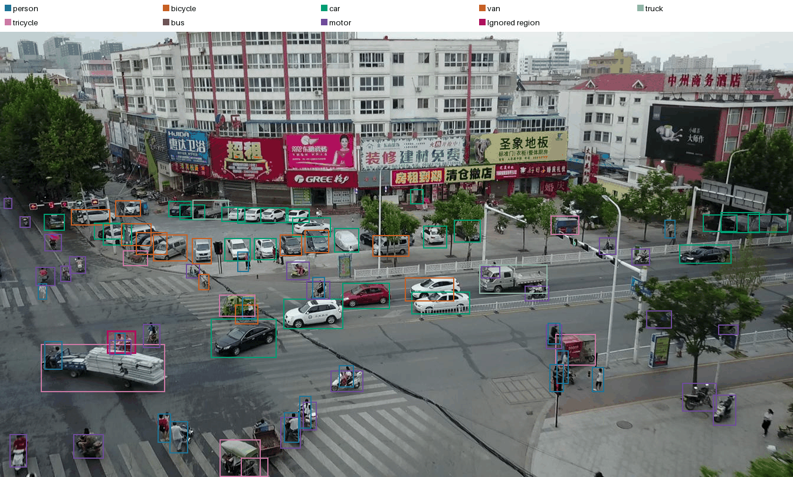
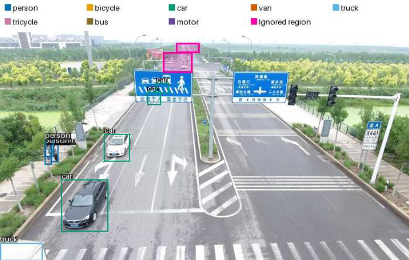
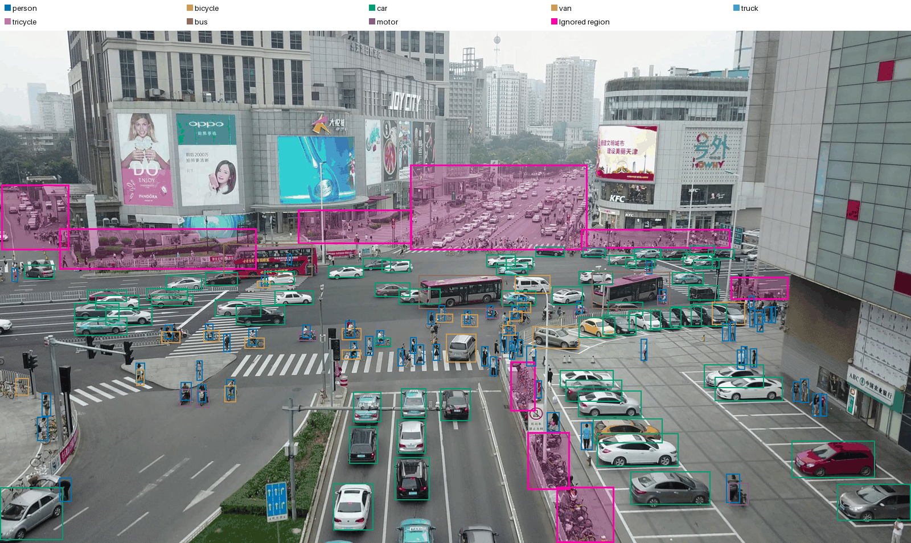
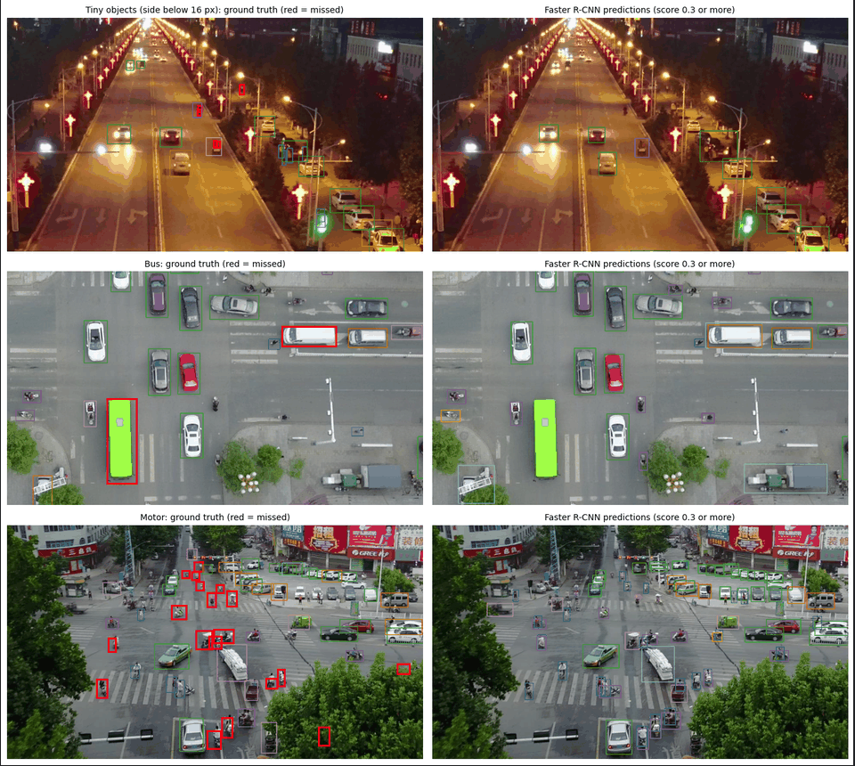
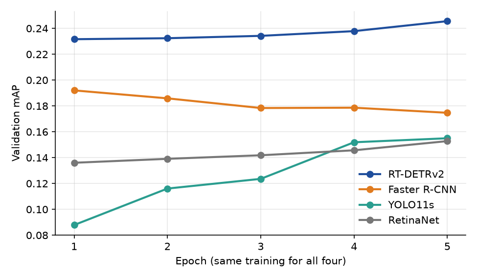

## Summary

The task is to find objects in drone videos (VisDrone2019-VID) and mark each with a box and one of eight classes. Most objects are small, and scenes are often crowded. Areas called ignore regions are too crowded to annotate, so detections there are not counted as mistakes.

We trained four detector families under the same budget: two-stage (Faster R-CNN), one-stage with
anchors (RetinaNet), one-stage without anchors (YOLO11s) and query-based (RT-DETRv2). With this equal
training, RT-DETRv2 was the most accurate.

The final pipeline builds on these experiments. Objects are tiny, so it uses larger images (1280 pixels). For the final model we chose YOLO11s and used a stronger recipe, started from weights of a public model trained on a similar drone dataset, VisDrone-DET (external data). The final model reaches Public score 0.362.

## Data and preprocessing

<!--
- Class distribution, object sizes and number of objects per frame, and how they differ between video clips.
Car and person are most of the boxes, bus is under 1 percent
- Which observations led to which choices
- Annotation conversion (COCO to YOLO), how ignore regions and non-target classes are handled
- The split by video clip, not by frame, and why
- Resizing, normalization and augmentation
-->

## Evaluation protocol

The first runs (RetinaNet, Faster R-CNN, RT-DETRv2, YOLO11s baseline) share one setup: 4,868 training frames (every 5th frame of 56 clips), 2,846 validation frames from 7 other clips, image size 640 to 1024 pixels, 5 epochs, 2 images per update, seed 2026, left-right flip with probability 0.5, the last-epoch model, and a Kaggle T4 GPU.

A box is correct if it has the right class and overlaps the true box enough (IoU - the shared area divided by the area covered by at least one of the two boxes).

The main score is COCO mAP, which measures how well the model finds objects without false boxes, averaged over classes and over overlap thresholds from 0.50 to 0.95.

AP50 uses only the threshold 0.5, and AP small only objects below 32 by 32 pixels.

## Two-stage anchor-based: Faster R-CNN

Faster R-CNN works in two stages.

1. The region proposal network (RPN) decides where to look: it suggests boxes that may contain an object, starting from anchors, which are boxes of fixed size and shape placed all over the image.
2. The second stage decides what is there: it classifies each suggestion and corrects its box. Non-maximum suppression (NMS) then keeps the best of the overlapping boxes for one object.

We start from a model pretrained on COCO with a ResNet-50 backbone and train it with SGD at learning rate 0.0025. Our change is in the loss: a background candidate that is more than half covered by an ignore region is removed from the loss of both stages, so finding a real object there is not punished.

On validation, Faster R-CNN reaches mAP 0.175, AP50 0.354 and AP small 0.081, and needs 94 ms per frame.

**Failure cases** \
The figure shows the worst validation frames, not typical ones. At night, all 5 objects below 16 pixels are missed, probably because they are tiny and dark, so the first stage does not propose them. Both buses are missed (one gets a truck box), and buses are only 0.8 percent of all boxes. In a crowd, 21 of 25 motorcycles are missed although many riders are found, probably because a small motorcycle overlaps its rider. The score also falls during training (0.192 after epoch 1, 0.175 after epoch 5), possibly from overfitting.

Figure was made in a Kaggle notebook from the validation predictions of the last epoch (val_predictions.json)

### Tuning the two-stage detector

**Number of region proposals.** \
The first stage hands the second stage a fixed number of boxes per image after NMS. On the finished baseline we changed only this number at inference, with the same weights.

| Proposals per image | Val mAP | AP small | AP large | Public |
| ------------------- | ------- | -------- | -------- | ------ |
| 300                 | 0.1735  | 0.0807   | 0.331    | 0.201  |
| 1000 (baseline)     | 0.1747  | 0.0807   | 0.334    | 0.204  |
| 2000                | 0.1747  | 0.0806   | 0.334    | 0.204  |

More proposals do not help: from 300 to 2000 mAP changes by 0.001 and AP small not at all, and inference gets slower. So the weak result on tiny objects (AP small 0.081) does not come from the second stage running out of candidates. The limit is more likely the first stage, its anchors and feature map resolution.

<!-- TODO (after Kaggle run): positive_fraction_0_5. Write 3 sentences: the second change is the share of positive boxes among the 512 boxes the second stage trains on per image, raised from 0.25 to 0.5 (tiny objects are rare, so positives are few). Give val mAP, AP small and per-class changes from runs/.../positive_fraction_0_5, compare with the baseline 0.175 and 0.081, and say whether it helped. Then add its row to the appendix table and delete this comment. -->

### Data experiments

<!--
notebooks/06_photometric_augmentation.ipynb, 07_input_resolution.ipynb and 09_repeat_factor_sampling.ipynb
-->

## One-stage anchor-based: RetinaNet

## One-stage anchor-free: YOLO11s

## Query-based: RT-DETRv2

RT-DETRv2 has no anchors and no NMS. It has 300 queries, which are slots that the model learns, and each query returns one box and one class.

In training, every true box is paired with exactly one query (the Hungarian matching), and the other queries must say that there is no object. So a second box on the same object is punished, and the model learns not to make duplicates, which is why NMS is not needed.

At the start most queries are wrong, so the loss is high and falls quickly (from about 5 to 1 in the first thousand updates).

For setup we use the COCO-pretrained PekingU/rtdetr_v2_r50vd with the same budget as the other models (5 epochs, 24,340 image exposures). We changed the loss so that queries inside ignore regions are not punished.

Each experiment changes a single thing. NWD is a way to compare boxes that stays stable for tiny boxes. Denoising queries are extra training-only queries that start from slightly shifted true boxes and learn to fix them, which speeds up learning.

| Run           | Change                                                | Val mAP | Public |
| ------------- | ----------------------------------------------------- | ------- | ------ |
| baseline_q300 | none                                                  | 0.246   | 0.253  |
| nwd_loss      | NWD instead of GIoU, for tiny boxes                   | 0.239   | 0.241  |
| queries_500   | 500 queries instead of 300, for crowded frames        | 0.236   | 0.233  |
| denoising_300 | 300 denoising queries instead of 100, to learn faster | 0.237   | 0.247  |

**Results**\
The baseline is the best run (0.246, AP50 0.460, AP small 0.104). The three variants differ from it by about 0.01 with one seed each, so none is reliably better. NWD has the best AP small of the four runs (0.106), but it loses 0.006 mAP overall. 500 queries did not help frames with more than 100 objects (0.313 against 0.337 for the baseline). The baseline was still improving in the last epoch (by 0.008), so five epochs is too short for it.

Without NMS, RT-DETRv2 makes duplicate boxes (51 per 100 boxes at confidence 0.05), but they have low scores, and adding NMS changes mAP by less than 0.001. The comparison with the other families is in Results and analysis.

## Our pipeline

## Results and analysis

Validation mAP is on the official validation clips. The table shows the best experiment of each family, chosen by validation mAP (YOLO11s by Public, because VisDrone-DET contains frames of the validation clips, so it has no comparable validation score). All experiments are in the Appendix.

| Family                | Best experiment                        | Val mAP | Public |
| --------------------- | -------------------------------------- | ------- | ------ |
| Two-stage             | Faster R-CNN, image size 800 by 1280   | 0.209   | 0.194  |
| One-stage, anchors    | RetinaNet, smaller anchors, all frames | 0.156   | 0.160  |
| Query-based           | RT-DETRv2 baseline                     | 0.246   | 0.253  |
| One-stage, no anchors | YOLO11s, tuned final model             | –       | 0.362  |

Same training for all families. The first runs of the four families use the same training (5 epochs, 24,340 image exposures), so they can be compared directly.

| Model (same training)       | mAP   | AP50  | AP small | AP large | Training min |
| --------------------------- | ----- | ----- | -------- | -------- | ------------ |
| RetinaNet, standard anchors | 0.153 | 0.291 | 0.053    | 0.317    | 59.6         |
| Faster R-CNN                | 0.175 | 0.354 | 0.081    | 0.334    | 75.6         |
| YOLO11s                     | 0.155 | 0.298 | 0.092    | 0.285    | 23.7         |
| RT-DETRv2                   | 0.246 | 0.460 | 0.104    | 0.443    | 96.7         |

RT-DETRv2 is clearly the best, but it also trains the longest. YOLO11s trains the fastest and has the best AP small among the CNN-based models. All four families find small objects much worse than large ones (AP small 0.05 to 0.10, AP large 0.28 to 0.44). On frames with more than 100 objects, RT-DETRv2 scores 0.337, against 0.250 for Faster R-CNN and 0.189 for RetinaNet (YOLO11s was not measured). The figure shows the validation mAP after each epoch: RT-DETRv2 stays on top and keeps rising, RetinaNet and YOLO11s are still rising at epoch 5, and Faster R-CNN gets worse after epoch 1.

<!--
add YOLO11s to the sentence about frames with more than 100 objects.
-->

Car is the easiest class for all four families. Bus and motor are the hardest for the CNN-based models (AP 0.015 to 0.038 for bus and 0.067 to 0.090 for motor), and only RT-DETRv2 finds buses well (0.265). Bus is rare (0.8 percent of all boxes and only 264 boxes in validation), so its scores are unstable.

Validation and Public can disagree: the larger image gave Faster R-CNN its best validation mAP (0.209) but its lowest Public score (0.194). Both sets are small (7 and about 14 clips).

Limitations. Each run has one random seed, training is short, and we report the last epoch, not the
best one. Times were measured on Kaggle and may vary between sessions.

## Final model and run instructions

<!--
name the selected model, and explain how to rebuild it and its predictions -->

Faster R-CNN and RT-DETRv2 can be rebuilt with the configurations config/faster_rcnn_baseline.toml and
config/rt_detr_baseline.toml (seed 2026), the Kaggle notebooks experiments/02_faster_rcnn_experiments_kaggle.ipynb
and experiments/03_rt_detr_experiments_kaggle.ipynb, and the code in src/hm2/faster_rcnn.py and
src/hm2/rt_detr.py. Tests run with uv run pytest.

## Appendix: all experiments

Validation mAP and Kaggle Public score of every experiment.

| Experiment                                     | Val mAP | Public | Code             |
| ---------------------------------------------- | ------- | ------ | ---------------- |
| RetinaNet, standard anchors, every 5th frame   | 0.153   | 0.160  | notebooks 02, 03 |
| RetinaNet, smaller anchors, every 5th frame    | 0.149   | 0.142  | notebooks 02, 03 |
| RetinaNet, standard anchors, all frames        | 0.151   | 0.168  | notebooks 02, 03 |
| RetinaNet, smaller anchors, all frames         | 0.156   | 0.160  | notebooks 02, 03 |
| Faster R-CNN (ignore-aware)                    | 0.175   | 0.204  | notebook 04      |
| Faster R-CNN, brightness and contrast changes  | 0.179   | 0.199  | notebook 06      |
| Faster R-CNN, showing rare classes more often  | 0.182   | 0.196  | notebook 09      |
| Faster R-CNN, image size 800 by 1280           | 0.209   | 0.194  | notebook 07      |
| Faster R-CNN, 300 proposals (inference only)   | 0.174   | 0.201  | notebook 02      |
| Faster R-CNN, 2000 proposals (inference only)  | 0.175   | 0.204  | notebook 02      |
| RT-DETRv2 baseline                             | 0.246   | 0.253  | notebook 05      |
| RT-DETRv2, NWD loss                            | 0.239   | 0.241  | notebook 05      |
| RT-DETRv2, 500 queries                         | 0.236   | 0.233  | notebook 05      |
| RT-DETRv2, 300 denoising queries               | 0.237   | 0.247  | notebook 05      |
| YOLO11s, shared setup                          | 0.155   | 0.143  | notebook 08      |
| YOLO11s from VisDrone-DET, no fine-tuning      | –       | 0.280  | notebook 10      |
| YOLO11s, one epoch of fine-tuning, 1280 pixels | –       | 0.344  | notebook 10      |
| YOLO11s, frames with stride 2                  | –       | 0.338  | notebook 10      |
| YOLO11s, lower learning rate                   | –       | 0.346  | notebook 10      |
| YOLO11s, frozen backbone                       | –       | 0.348  | notebook 10      |
| YOLO11s, larger classification loss gain       | –       | 0.349  | notebook 10      |
| YOLO11s, tuned final model                     | –       | 0.362  | notebook 10      |
