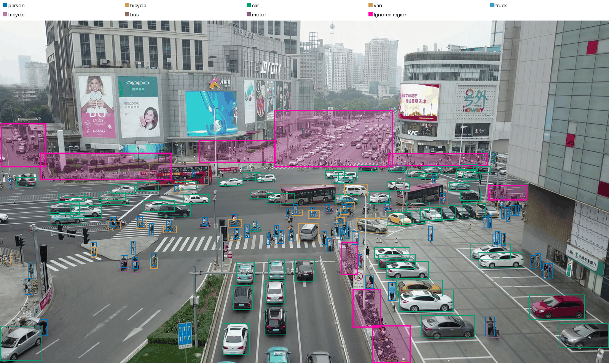

## Summary

The task is to find objects in drone videos (VisDrone2019-VID) and mark each with a box and one of eight classes. Most objects are small, and scenes are often crowded. Areas called ignore regions are too crowded to annotate, so detections there are not counted as mistakes.

We trained four detector families under the same budget: two-stage (Faster R-CNN), one-stage with
anchors (RetinaNet), one-stage without anchors (YOLO11s) and query-based (RT-DETRv2). With this equal
training, RT-DETRv2 was the most accurate.

The final pipeline builds on these experiments. Objects are tiny, so it uses larger images (1280 pixels). For the final model we chose YOLO11s and used a stronger recipe, started from weights of a public model trained on a similar drone dataset, VisDrone-DET (external data). The final model reaches Public score 0.362.
## EDA (Exploratory Data Analysis)

During the EDA phase, our goal was to understand the dataset and make sure that nothing in it would silently invalidate training or evaluation.

Remark about coordinate systems:

The dataset uses three conventions.

This could cause issues, as a conversion error still produces a valid file that scores near zero.

YOLO labels store the box center and size normalized to the image width and height, with class IDs 0 to 7.

COCO annotations store the top-left corner and size in the original pixels, with category IDs 1 to 8.

The submission expects the COCO layout in original pixels but the YOLO class IDs. We convert with $x = (c_x - w/2) W$, $y = (c_y - h/2) H$, width $w W$, height $h H$ and class = category - 1. Ignored regions use the YOLO layout without a class. Our final model sees a frame resized so that its longer side is 1280 px.

### EDA Findings

Object size: 24.4% of the boxes are COCO small (by COCO convention, below 32x32 px), with median areas from 1 344 $\mathrm{px}^2$ for person to 12 470 $\mathrm{px}^2$ for bus ([01_eda, Section 4](https://nbviewer.org/github/ke1rro/hm2/blob/main/notebooks/01_eda.ipynb#4.-Object-sizes)).

The relevant size is the one after resizing, however. With a 1024 px long side, as in our first detectors, the median box side is 24 px ([02_retinanet, Section 4](https://nbviewer.org/github/ke1rro/hm2/blob/main/notebooks/02_retinanet.ipynb#4.-Smaller-anchor-scales)). With a 1280 px long side, the median is 30 px and 9.5% are below 16 px ([10_yolo11s_native_pipeline, Section 4](https://nbviewer.org/github/ke1rro/hm2/blob/main/notebooks/10_yolo11s_native_pipeline.ipynb#4.-Sampling-summary-and-annotation-checks)). The final model therefore uses 1280 px.

Density: A training frame contains 45.7 objects on average, with a median of 43, a 99th percentile of 142 and a maximum of 180 ([01_eda, Section 5](https://nbviewer.org/github/ke1rro/hm2/blob/main/notebooks/01_eda.ipynb#5.-Objects-per-frame)). We use a confidence threshold of 0.001 and up to 500 detections per frame. Raising the threshold to 0.05 lowered mAP by 0.39 points ([11_yolo11s_tuning_experiments, Section 6](https://nbviewer.org/github/ke1rro/hm2/blob/main/notebooks/11_yolo11s_tuning_experiments.ipynb#6.-Inference-strategies-on-the-best-checkpoint)).

Class imbalance: Car accounts for 44.0% of the boxes, person 31.1% and bus for 0.8% ([01_eda, Section 3](https://nbviewer.org/github/ke1rro/hm2/blob/main/notebooks/01_eda.ipynb#3.-Class-distribution)).

On the clean validation fold, AP follows object size more than frequency: bus reaches 0.66 and bicycle 0.13 ([10_yolo11s_native_pipeline, Section 10](https://nbviewer.org/github/ke1rro/hm2/blob/main/notebooks/10_yolo11s_native_pipeline.ipynb#10.-Per-class,-size-and-clip-results)). Repeat-factor sampling did not give a consistent gain ([09_repeat_factor_sampling, Section 7](https://nbviewer.org/github/ke1rro/hm2/blob/main/notebooks/09_repeat_factor_sampling.ipynb#7.-Interpretation-and-limitations)). The failure analysis shows that among predictions with score at least 0.3, 24 to 29% of van, truck and bicycle objects are assigned to another class ([10_yolo11s_native_pipeline, Section 11](https://nbviewer.org/github/ke1rro/hm2/blob/main/notebooks/10_yolo11s_native_pipeline.ipynb#11.-Failure-analysis)).

Train and test: labeled frames are 1344 to 3840 px wide, while test frames are 680 to 1920 px ([01_eda, Section 6](https://nbviewer.org/github/ke1rro/hm2/blob/main/notebooks/01_eda.ipynb#6.-Resolution-and-split-differences)).

Independence: the same object keeps a median IoU of 0.90 between neighboring frames ([10_yolo11s_native_pipeline, Section 4](https://nbviewer.org/github/ke1rro/hm2/blob/main/notebooks/10_yolo11s_native_pipeline.ipynb#4.-Sampling-summary-and-annotation-checks)), so every split keeps whole clips and the final validation is grouped by video ([12_yolo11s_grouped_cv, Section 2](https://nbviewer.org/github/ke1rro/hm2/blob/main/notebooks/12_yolo11s_grouped_cv.ipynb#2.-Validation-pool-and-folds)).

## Evaluation

In this homework, we used RetinaNet, Faster R-CNN, RT-DETRv2 and YOLO11s.
Their first runs used the same setup:

4,868 training frames (every 5th frame of 56 clips), 2,846 validation frames from 7 other clips, images resized to a shorter side of 640 and a longer side of at most 1024 pixels, 5 epochs, 2 images per update, seed 2026, left-right flip with probability 0.5.

All four start from COCO-pretrained weights, and Faster R-CNN, RetinaNet and RT-DETRv2 share a ResNet-50 backbone, so their differences come mainly from the detection head and the way predictions are assigned to objects, not from feature extraction.

The later YOLO11s pipeline starts instead from weights trained on VisDrone-DET, so its gain over these runs comes from initialization and data, not from the architecture alone.

Our metrics for a predicted box $B_p$ and a ground-truth box $B_g$,

$$\mathrm{IoU}(B_p, B_g) = \frac{|B_p \cap B_g|}{|B_p \cup B_g|}.$$

For one class and one IoU threshold $t$, predictions are sorted by score and matched greedily: a prediction is a true positive if it has the same class and $\mathrm{IoU} \ge t$ with a ground-truth box that is not matched yet, and a false positive otherwise. Walking down the sorted list gives precision $P = TP/(TP + FP)$ and recall $R = TP/N_{gt}$. COCO averages the interpolated precision $P_{\mathrm{interp}}(r) = \max_{r' \ge r} P(r')$ at 101 recall levels:

$$\mathrm{AP}_{c,t} = \frac{1}{101} \sum_{r \in \{0, 0.01, \dots, 1\}} P_{\mathrm{interp}}(r).$$

The main score averages this over the 8 classes and the 10 thresholds $T = \{0.50, 0.55, \dots, 0.95\}$:

$$\mathrm{mAP} = \frac{1}{8 \cdot 10} \sum_{c} \sum_{t \in T} \mathrm{AP}_{c,t}.$$

AP50 uses only $t = 0.5$, and AP small counts only ground-truth boxes with an area below $32^2$ $\mathrm{px}^2$ in the original image. At most 100 detections per image and class are kept. Ignored regions enter as COCO crowd regions: a detection that falls inside one, measured as the share of the detection covered by the region, is removed instead of counted as a false positive. The Kaggle metric is not published, so this COCO mAP is our proxy, and the Public leaderboard (about 14 test clips) is a second, noisy measurement.

## Two-stage anchor-based: Faster R-CNN

Faster R-CNN works in two stages.

1. The region proposal network (RPN) decides where to look: it suggests boxes that may contain an object, starting from anchors, which are boxes of fixed size and shape placed all over the image.
2. The second stage decides what is there: it classifies each suggestion and corrects its box. Non-maximum suppression (NMS) then keeps the best of the overlapping boxes for one object.

We start from a model pretrained on COCO with a ResNet-50 backbone and train it with SGD at learning rate 0.0025. Our change is in the loss: a background candidate that is more than half covered by an ignore region is removed from the loss of both stages, so finding a real object there is not punished.

On validation, Faster R-CNN reaches mAP 0.175, AP50 0.354 and AP small 0.081, and needs 94 ms per frame.
я хочу шоб ти зліпив мій репорт на цій гілці з тим, шо зробив мій тімейт, на мейн гілці. до того що на мейні треба додати все момої частини пісял
**Failure cases** \
The figure shows the worst validation frames, not typical ones. At night, all 5 objects below 16 pixels are missed, probably because they are tiny and dark, so the first stage does not propose them. Both buses are missed (one gets a truck box), and buses are only 0.8 percent of all boxes. In a crowd, 21 of 25 motorcycles are missed although many riders are found, probably because a small motorcycle overlaps its rider. The score also falls during training (0.192 after epoch 1, 0.175 after epoch 5), possibly from overfitting.

Figure was made in a Kaggle notebook from the validation predictions of the last epoch (val_predictions.json)

### Tuning the two-stage detector

**Number of region proposals.** \
The first stage hands the second stage a fixed number of boxes per image after NMS. On the finished baseline we changed only this number at inference, with the same weights.

| Proposals per image | Val mAP | AP small | AP large | Public |
| ------------------- | ------- | -------- | -------- | ------ |
| 300                 | 0.1735  | 0.0807   | 0.331    | 0.201  |
| 1000 (baseline)     | 0.1747  | 0.0807   | 0.334    | 0.204  |
| 2000                | 0.1747  | 0.0806   | 0.334    | 0.204  |

More proposals do not help: from 300 to 2000 mAP changes by 0.001 and AP small not at all, and inference gets slower. So the weak result on tiny objects (AP small 0.081) does not come from the second stage running out of candidates. The limit is more likely the first stage, its anchors and feature map resolution.

**Share of positive boxes.** \
The second stage trains on 512 boxes per image, and only 25 percent of them were positive. Tiny objects are rare, so we raised the share to 50 percent and kept everything else. Validation mAP hardly changed (0.177 against 0.175), AP small was a little lower (0.077 against 0.081), and bus improved most (0.039 against 0.015). The Public score rose from 0.204 to 0.213, the best of all our Faster R-CNN runs at the shared image size. With one seed and 14 test clips, a gain of 0.009 may be noise, so we do not claim that more positives is better. The score still falls after epoch 1 (0.200 after epoch 1, 0.177 after epoch 5), as in the baseline.

### Data experiments

<!--
notebooks/06_photometric_augmentation.ipynb, 07_input_resolution.ipynb and 09_repeat_factor_sampling.ipynb
-->

## One-stage anchor-based: RetinaNet

We fine-tuned the COCO-pretrained RetinaNet ResNet-50 FPN V2 and ran four experiments in a 2x2 design: standard or halved anchor sizes, trained on every fifth frame (4,868) or on all 24,201 frames ([02_retinanet, Section 1](https://nbviewer.org/github/ke1rro/hm2/blob/main/notebooks/02_retinanet.ipynb#1.-Setup-and-training-configuration), [03_retinanet_results, Section 2](https://nbviewer.org/github/ke1rro/hm2/blob/main/notebooks/03_retinanet_results.ipynb#2.-Validation-at-epoch-5)). Halving the anchors targets the small objects found in the EDA, and the full training set tests whether more frames help.

| Anchors  | Frames    | Checkpoint |   mAP |  AP50 | AP small | AP large | Public |
| -------- | --------- | ---------- | ----: | ----: | -------: | -------: | -----: |
| standard | every 5th | epoch 5    | 0.153 | 0.291 |    0.053 |    0.317 |  0.160 |
| halved   | every 5th | epoch 5    | 0.149 | 0.316 |    0.052 |    0.276 |  0.142 |
| standard | all       | epoch 1    | 0.158 | 0.299 |    0.053 |    0.327 |  0.168 |
| halved   | all       | epoch 4    | 0.159 | 0.333 |    0.058 |    0.306 |  0.160 |

The initial frame size is up to 3840x2160 px, and our setup used batch size 2 and 5 epochs. Full size frames would not fit into our Tesla T4 budget, so we resized the shorter side to 640 px and the longer side to at most 1024 px (1024x576 for our frames).

The smallest standard anchor is 32 px, so a 13 px box (the 10th percentile) reaches an IoU of at most $13^2/32^2 \approx 0.17$ with it and is never a regular positive. 

Halved anchors start at 16 px (IoU up to 0.66). They raised AP50 in both data settings (+2.5 and +3.9 points at epoch 5), so more small objects are found. AP small barely moved (-0.1 and +0.5 points), however, and AP large fell (-4.0 and -1.7 points). The clearest loser is bus, the largest class: its AP fell from 0.038 to 0.009 with every fifth frame and from 0.087 to 0.013 with all frames ([03_retinanet_results, Section 5](https://nbviewer.org/github/ke1rro/hm2/blob/main/notebooks/03_retinanet_results.ipynb#5.-Class-AP-at-epoch-5)). Smaller anchors trade large objects for coarse detection of small ones, while precise localization of small objects stays limited by the resolution of the input.

Just to prove that full dataset does not necessarily lead to better performance, training on all frames gave five times more updates but no consistent gain (-0.2 and +0.8 points mAP at epoch 5). That is why we stayed on using stride values in our experiments. 

Comparison with Faster R-CNN. Under the same budget RetinaNet with standard anchors reached 0.153 mAP and 0.053 AP small, against 0.175 and 0.081 for Faster R-CNN, and 0.160 against 0.204 on Public. The comparison is not purely about the architecture: stock RetinaNet treats ignored regions as background, while our Faster R-CNN excludes negatives inside them.

Here is example of dense validation frame below, cars and pedestrians are found reliably, but there are a few mispredictions: several bicycles are predicted as motor.

## One-stage anchor-free: YOLO11s

## Query-based: RT-DETRv2

RT-DETRv2 has no anchors and no NMS. It has 300 queries, which are slots that the model learns, and each query returns one box and one class.

In training, every true box is paired with exactly one query (the Hungarian matching), and the other queries must say that there is no object. So a second box on the same object is punished, and the model learns not to make duplicates, which is why NMS is not needed.

At the start most queries are wrong, so the loss is high and falls quickly (from about 5 to 1 in the first thousand updates).

For setup we use the COCO-pretrained PekingU/rtdetr_v2_r50vd with the same budget as the other models (5 epochs, 24,340 image exposures). We changed the loss so that queries inside ignore regions are not punished.

Each experiment changes a singlя хочу шоб ти зліпив мій репорт на цій гілці з тим, шо зробив мій тімейт, на мейн гілці. до того що на мейні треба додати все момої частини пісялe thing. NWD is a way to compare boxes that stays stable for tiny boxes. Denoising queries are extra training-only queries that start from slightly shifted true boxes and learn to fix them, which speeds up learning.

| Run           | Change                                                | Val mAP | Public |
| ------------- | ----------------------------------------------------- | ------- | ------ |
| baseline_q300 | none                                                  | 0.246   | 0.253  |
| nwd_loss      | NWD instead of GIoU, for tiny boxes                   | 0.239   | 0.241  |
| queries_500   | 500 queries instead of 300, for crowded frames        | 0.236   | 0.233  |
| denoising_300 | 300 denoising queries instead of 100, to learn faster | 0.237   | 0.247  |

**Results**\
The baseline is the best run (0.246, AP50 0.460, AP small 0.104). The three variants differ from it by about 0.01 with one seed each, so none is reliably better. NWD has the best AP small of the four runs (0.106), but it loses 0.006 mAP overall. 500 queries did not help frames with more than 100 objects (0.313 against 0.337 for the baseline). The baseline was still improving in the last epoch (by 0.008), so five epochs is too short for it.

Without NMS, RT-DETRv2 makes duplicate boxes (51 per 100 boxes at confidence 0.05), but they have low scores, and adding NMS changes mAP by less than 0.001. The comparison with the other families is in Results and analysis.

## Our pipeline

## Results and analysis

Validation mAP is on the official validation clips. The table shows the best experiment of each family, chosen by validation mAP (YOLO11s by Public, because VisDrone-DET contains frames of the validation clips, so it has no comparable validation score). All experiments are in the Appendix.

| Family                | Best experiment                        | Val mAP | Public |
| --------------------- | -------------------------------------- | ------- | ------ |
| Two-stage             | Faster R-CNN, image size 800 by 1280   | 0.209   | 0.194  |
| One-stage, anchors    | RetinaNet, smaller anchors, all frames | 0.156   | 0.160  |
| Query-based           | RT-DETRv2 baseline                     | 0.246   | 0.253  |
| One-stage, no anchors | YOLO11s, tuned final model             | –       | 0.362  |

Same training for all families. The first runs of the four families use the same training (5 epochs, 24,340 image exposures), so they can be compared directly.

| Model (same training)       | mAP   | AP50  | AP small | AP large | Training min |
| --------------------------- | ----- | ----- | -------- | -------- | ------------ |
| RetinaNet, standard anchors | 0.153 | 0.291 | 0.053    | 0.317    | 59.6         |
| Faster R-CNN                | 0.175 | 0.354 | 0.081    | 0.334    | 75.6         |
| YOLO11s                     | 0.155 | 0.298 | 0.092    | 0.285    | 23.7         |
| RT-DETRv2                   | 0.246 | 0.460 | 0.104    | 0.443    | 96.7         |

RT-DETRv2 is clearly the best, but it also trains the longest. YOLO11s trains the fastest and has the best AP small among the CNN-based models. All four families find small objects much worse than large ones (AP small 0.05 to 0.10, AP large 0.28 to 0.44). On frames with more than 100 objects, RT-DETRv2 scores 0.337, against 0.250 for Faster R-CNN and 0.189 for RetinaNet (YOLO11s was not measured). The figure shows the validation mAP after each epoch: RT-DETRv2 stays on top and keeps rising, RetinaNet and YOLO11s are still rising at epoch 5, and Faster R-CNN gets worse after epoch 1.

<!--
add YOLO11s to the sentence about frames with more than 100 objects.
-->

Car is the easiest class for all four families. Bus and motor are the hardest for the CNN-based models (AP 0.015 to 0.038 for bus and 0.067 to 0.090 for motor), and only RT-DETRv2 finds buses well (0.265). Bus is rare (0.8 percent of all boxes and only 264 boxes in validation), so its scores are unstable.

Validation and Public can disagree: the larger image gave Faster R-CNN its best validation mAP (0.209) but its lowest Public score (0.194). Both sets are small (7 and about 14 clips).

Limitations. Each run has one random seed, training is short, and we report the last epoch, not the
best one. Times were measured on Kaggle and may vary between sessions.

## Final model and run instructions

<!--
name the selected model, and explain how to rebuild it and its predictions -->

Faster R-CNN and RT-DETRv2 can be rebuilt with the configurations config/faster_rcnn_baseline.toml and
config/rt_detr_baseline.toml (seed 2026), the Kaggle notebooks experiments/02_faster_rcnn_experiments_kaggle.ipynb
and experiments/03_rt_detr_experiments_kaggle.ipynb, and the code in src/hm2/faster_rcnn.py and
src/hm2/rt_detr.py. Tests run with uv run pytest.

## Appendix: all experiments

Validation mAP and Kaggle Public score of every experiment.

| Experiment                                     | Val mAP | Public | Code             |
| ---------------------------------------------- | ------- | ------ | ---------------- |
| RetinaNet, standard anchors, every 5th frame   | 0.153   | 0.160  | notebooks 02, 03 |
| RetinaNet, smaller anchors, every 5th frame    | 0.149   | 0.142  | notebooks 02, 03 |
| RetinaNet, standard anchors, all frames        | 0.151   | 0.168  | notebooks 02, 03 |
| RetinaNet, smaller anchors, all frames         | 0.156   | 0.160  | notebooks 02, 03 |
| Faster R-CNN (ignore-aware)                    | 0.175   | 0.204  | notebook 04      |
| Faster R-CNN, brightness and contrast changes  | 0.179   | 0.199  | notebook 06      |
| Faster R-CNN, showing rare classes more often  | 0.182   | 0.196  | notebook 09      |
| Faster R-CNN, image size 800 by 1280           | 0.209   | 0.194  | notebook 07      |
| Faster R-CNN, 300 proposals (inference only)   | 0.174   | 0.201  | notebook 02      |
| Faster R-CNN, 2000 proposals (inference only)  | 0.175   | 0.204  | notebook 02      |
| RT-DETRv2 baseline                             | 0.246   | 0.253  | notebook 05      |
| RT-DETRv2, NWD loss                            | 0.239   | 0.241  | notebook 05      |
| RT-DETRv2, 500 queries                         | 0.236   | 0.233  | notebook 05      |
| RT-DETRv2, 300 denoising queries               | 0.237   | 0.247  | notebook 05      |
| YOLO11s, shared setup                          | 0.155   | 0.143  | notebook 08      |
| YOLO11s from VisDrone-DET, no fine-tuning      | –       | 0.280  | notebook 10      |
| YOLO11s, one epoch of fine-tuning, 1280 pixels | –       | 0.344  | notebook 10      |
| YOLO11s, frames with stride 2                  | –       | 0.338  | notebook 10      |
| YOLO11s, lower learning rate                   | –       | 0.346  | notebook 10      |
| YOLO11s, frozen backbone                       | –       | 0.348  | notebook 10      |
| YOLO11s, larger classification loss gain       | –       | 0.349  | notebook 10      |
| YOLO11s, tuned final model                     | –       | 0.362  | notebook 10      |